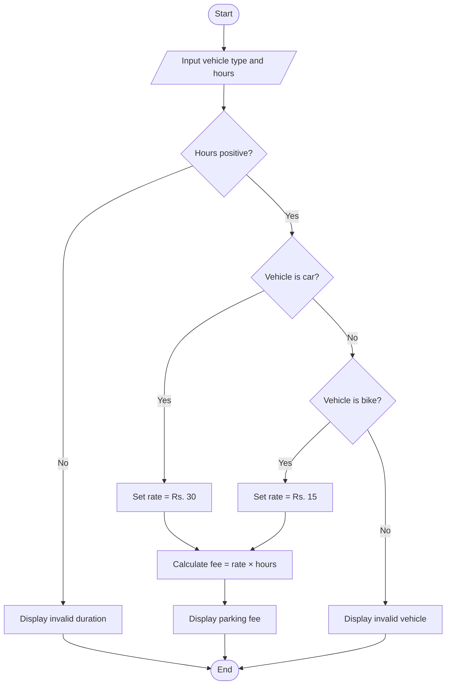

# Case Study 15: Smart Parking Fee Management

## Student Details

- **Name:** SIMHADRI RAJA SEKHARA REDDY
- **NRI Roll Number:** 26000784
- **NIAT ID:** N26V01A0424
- **Branch:** CSE
- **Section:** 5th Section
- **Year:** 1st Year

## 1. Problem Statement

Calculate parking charges using the number of hours parked and a simple vehicle category rate.

## 2. Objectives

- Accept vehicle category and parking duration.
- Calculate fees using conditional statements.
- Display a clear parking receipt.

## 3. Assumptions

- Parking duration is entered as a positive number of hours.
- Rates are sample rates for this academic exercise.
- Car rate is Rs. 30 per hour and bike rate is Rs. 15 per hour.

## 4. Algorithm

1. Read vehicle type and hours parked.
2. Validate hours and vehicle type.
3. Select the hourly rate based on vehicle type.
4. Calculate total fee.
5. Display vehicle, duration, rate, and fee.

## 5. Flowchart



## 6. Pseudocode

```text
START
INPUT vehicle, hours
IF hours <= 0: DISPLAY invalid duration
ELSE IF vehicle is CAR: rate = 30
ELSE IF vehicle is BIKE: rate = 15
ELSE: DISPLAY invalid vehicle
fee = rate * hours
DISPLAY fee
STOP
```

## 7. Python Source Code

See `main.py` in this folder. The program uses beginner-level Python concepts from the prescribed syllabus.

## 8. Test Cases

| Test | Input / condition | Expected result |
|---|---|---|
| 1 | car; 3 | Rs. 90 |
| 2 | bike; 2 | Rs. 30 |

## 9. Sample Output

See `sample_output.txt` and `output_screenshot.png`.

```text
Enter vehicle type (car/bike): car
Enter parking duration in hours: 3
Parking fee: Rs. 90.00
```

## 10. Conclusion

The program calculates a basic parking fee using user input, selection, and multiplication.
