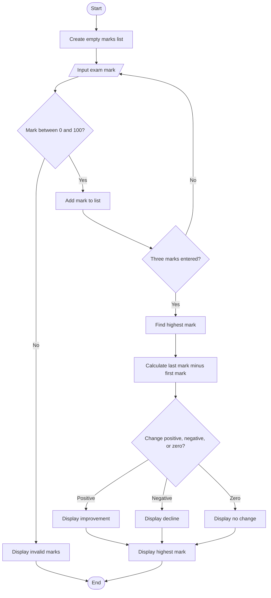

# Case Study 17: Student Performance Trend Analysis

## Student Details

- **Name:** SIMHADRI RAJA SEKHARA REDDY
- **NRI Roll Number:** 26000784
- **NIAT ID:** N26V01A0424
- **Branch:** CSE
- **Section:** 5th Section
- **Year:** 1st Year

## 1. Problem Statement

Compare a student's marks in three examinations, calculate improvement or decline, and identify the highest score.

## 2. Objectives

- Store marks in a list.
- Use loops to process scores.
- Compare values and calculate score changes.

## 3. Assumptions

- Marks are out of 100.
- Exactly three examination scores are entered.
- All marks must be between 0 and 100.

## 4. Algorithm

1. Read three examination marks into a list.
2. Validate each mark.
3. Find the highest mark using max().
4. Compare the first and last marks.
5. Display improvement or decline and the highest mark.

## 5. Flowchart



## 6. Pseudocode

```text
START
SET marks = empty list
REPEAT 3 TIMES: INPUT mark; validate; APPEND mark
highest = maximum of marks
change = marks[2] - marks[0]
IF change > 0: DISPLAY improvement
ELSE IF change < 0: DISPLAY decline
ELSE: DISPLAY no change
DISPLAY highest
STOP
```

## 7. Python Source Code

See `main.py` in this folder. The program uses beginner-level Python concepts from the prescribed syllabus.

## 8. Test Cases

| Test | Input / condition | Expected result |
|---|---|---|
| 1 | 60; 70; 80 | Highest 80; improvement 20 |
| 2 | 80; 70; 60 | Highest 80; decline 20 |

## 9. Sample Output

See `sample_output.txt` and `output_screenshot.png`.

```text
Enter exam 1 marks (0-100): 60
Enter exam 2 marks (0-100): 70
Enter exam 3 marks (0-100): 80
Highest mark: 80.00
Improvement: 20.00 marks
```

## 10. Conclusion

The program uses a list and comparisons to summarize a student's examination performance trend.
