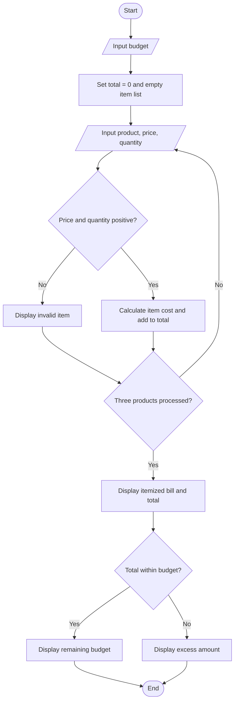

# Case Study 19: Multi-Product Shopping Budget Constraint

## Student Details

- **Name:** SIMHADRI RAJA SEKHARA REDDY
- **NRI Roll Number:** 26000784
- **NIAT ID:** N26V01A0424
- **Branch:** CSE
- **Section:** 5th Section
- **Year:** 1st Year

## 1. Problem Statement

Calculate the total cost of a small shopping basket and check whether it fits within the customer's budget.

## 2. Objectives

- Store product prices and quantities in lists.
- Calculate item totals and the basket total.
- Compare the total with a budget.

## 3. Assumptions

- Three products are entered.
- Prices and quantities must be positive.
- No discounts or taxes are applied in this basic version.

## 4. Algorithm

1. Read the budget.
2. For each of three products, read its name, price, and quantity.
3. Validate price and quantity.
4. Calculate each item cost and add it to the total.
5. Compare total cost with budget.
6. Display the bill and remaining amount or excess.

## 5. Flowchart



## 6. Pseudocode

```text
START
INPUT budget
SET total = 0
REPEAT 3 TIMES
  INPUT name, price, quantity
  IF price > 0 AND quantity > 0: item = price * quantity; total = total + item
  ELSE: DISPLAY invalid item
IF total <= budget: DISPLAY within budget and balance
ELSE: DISPLAY amount over budget
STOP
```

## 7. Python Source Code

See `main.py` in this folder. The program uses beginner-level Python concepts from the prescribed syllabus.

## 8. Test Cases

| Test | Input / condition | Expected result |
|---|---|---|
| 1 | 1000; book,200,2; pen,20,5; bag,300,1 | Total Rs. 800; remaining Rs. 200 |
| 2 | 500; book,200,2; pen,20,5; bag,300,1 | Over budget by Rs. 300 |

## 9. Sample Output

See `sample_output.txt` and `output_screenshot.png`.

```text
Enter your shopping budget: 1000
Enter product 1 name: book
Enter price: 200
Enter quantity: 2
Enter product 2 name: pen
Enter price: 20
Enter quantity: 5
Enter product 3 name: bag
Enter price: 300
Enter quantity: 1

SHOPPING BILL
book: Rs. 400.00
pen: Rs. 100.00
bag: Rs. 300.00
Total: Rs. 800.00
Within budget. Remaining: Rs. 200.00
```

## 10. Conclusion

The program creates a simple itemized bill using lists and tuples and checks the total against a budget.
