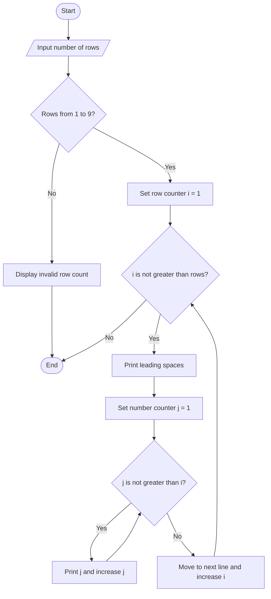

# Case Study 27: Advanced Numeric Pattern Generator

## Student Details

- **Name:** SIMHADRI RAJA SEKHARA REDDY
- **NRI Roll Number:** 26000784
- **NIAT ID:** N26V01A0424
- **Branch:** CSE
- **Section:** 5th Section
- **Year:** 1st Year

## 1. Problem Statement

Generate a centered numeric pyramid pattern for a user-specified number of rows.

## 2. Objectives

- Use nested loops.
- Generate a formatted pattern.
- Validate the number of rows.

## 3. Assumptions

- The number of rows must be between 1 and 9 so each row is easy to read.
- The pattern uses increasing numbers from 1 to the row number.

## 4. Algorithm

1. Read the number of rows.
2. Check that it is between 1 and 9.
3. Use an outer loop for each row.
4. Print leading spaces using a loop.
5. Print numbers from 1 to the current row.
6. Move to the next line.

## 5. Flowchart



## 6. Pseudocode

```text
START
INPUT rows
IF rows < 1 OR rows > 9: DISPLAY invalid rows
ELSE
  FOR i FROM 1 TO rows
    PRINT spaces
    FOR j FROM 1 TO i: PRINT j
    MOVE TO NEXT LINE
STOP
```

## 7. Python Source Code

See `main.py` in this folder. The program uses beginner-level Python concepts from the prescribed syllabus.

## 8. Test Cases

| Test | Input / condition | Expected result |
|---|---|---|
| 1 | 4 | Centered pyramid with 4 rows |
| 2 | 0 | Invalid rows message |

## 9. Sample Output

See `sample_output.txt` and `output_screenshot.png`.

```text
Enter number of rows (1-9): 4
   1 
  1 2 
 1 2 3 
1 2 3 4 
```

## 10. Conclusion

The program demonstrates nested loops and string repetition to generate a numeric pattern.
