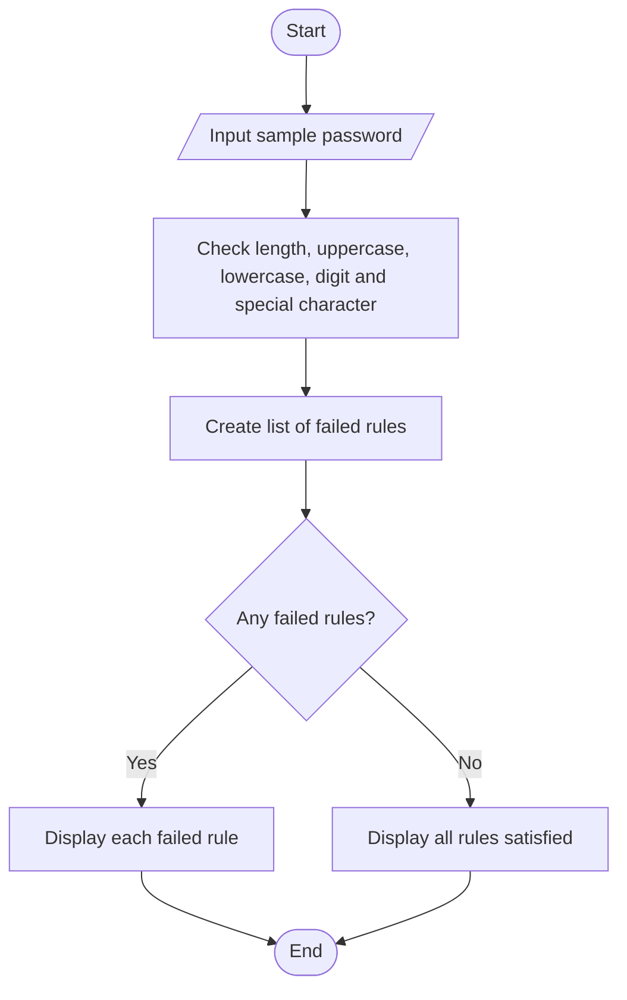

# Case Study 29: Password Policy Validation Engine

## Student Details

- **Name:** SIMHADRI RAJA SEKHARA REDDY
- **NRI Roll Number:** 26000784
- **NIAT ID:** N26V01A0424
- **Branch:** CSE
- **Section:** 5th Section
- **Year:** 1st Year

## 1. Problem Statement

Check a sample password against basic rules: minimum length, uppercase letter, lowercase letter, digit, and special character.

## 2. Objectives

- Process strings.
- Use built-in string checking methods.
- Report which password rules are not satisfied.

## 3. Assumptions

- The minimum length is 8 characters.
- A special character means any non-letter and non-digit character.
- This is a classroom validation example, not a complete security assessment.

## 4. Algorithm

1. Read a sample password.
2. Check its length.
3. Check for uppercase and lowercase letters.
4. Check for at least one digit and one special character.
5. Display each failed rule or a message that all rules are met.

## 5. Flowchart



## 6. Pseudocode

```text
START
INPUT password
SET errors = empty list
IF length < 8: ADD length rule to errors
IF no uppercase: ADD uppercase rule
IF no lowercase: ADD lowercase rule
IF no digit: ADD digit rule
IF no special character: ADD special rule
IF errors empty: DISPLAY rules satisfied
ELSE DISPLAY errors
STOP
```

## 7. Python Source Code

See `main.py` in this folder. The program uses beginner-level Python concepts from the prescribed syllabus.

## 8. Test Cases

| Test | Input / condition | Expected result |
|---|---|---|
| 1 | Raja@123 | All sample rules satisfied |
| 2 | raja123 | Length, uppercase, and special-character rules fail |

## 9. Sample Output

See `sample_output.txt` and `output_screenshot.png`.

```text
Enter a sample password to validate: Raja@123
All sample password rules are satisfied.
```

## 10. Conclusion

The program applies string methods and conditions to validate a sample password against stated rules.
