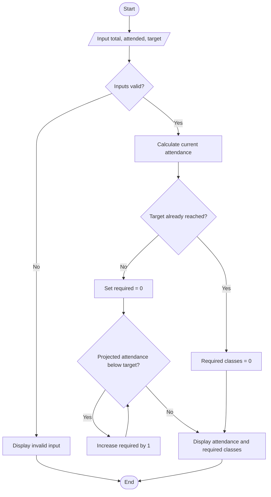

# Case Study 12: Attendance Recovery Computation

## Student Details

- **Name:** SIMHADRI RAJA SEKHARA REDDY
- **NRI Roll Number:** 26000784
- **NIAT ID:** N26V01A0424
- **Branch:** CSE
- **Section:** 5th Section
- **Year:** 1st Year

## 1. Problem Statement

Calculate a student's current attendance percentage and find the minimum number of consecutive classes the student must attend to reach a required attendance percentage.

## 2. Objectives

- Calculate attendance percentage.
- Use arithmetic and conditional statements.
- Use a loop to find the minimum future classes required.

## 3. Assumptions

- Total classes conducted is greater than zero.
- Attended classes cannot exceed total classes.
- The target attendance is between 1 and 100 percent.

## 4. Algorithm

1. Read total classes, attended classes, and target percentage.
2. Validate the inputs.
3. Calculate current attendance percentage.
4. If the target is already reached, display zero required classes.
5. Otherwise, increase future attended and total classes one at a time until the target is reached.
6. Display the result.

## 5. Flowchart



## 6. Pseudocode

```text
START
INPUT total, attended, target
IF total <= 0 OR attended < 0 OR attended > total: DISPLAY invalid input
ELSE
  percentage = attended / total * 100
  required = 0
  WHILE (attended + required) / (total + required) * 100 < target:
    required = required + 1
  DISPLAY percentage and required
STOP
```

## 7. Python Source Code

See `main.py` in this folder. The program uses beginner-level Python concepts from the prescribed syllabus.

## 8. Test Cases

| Test | Input / condition | Expected result |
|---|---|---|
| 1 | 60 | 45 | 75 | 75.00%; 0 additional classes |
| 2 | 80 | 50 | 75 | 62.50%; 40 additional classes |

## 9. Sample Output

See `sample_output.txt` and `output_screenshot.png`.

```text
Enter total classes conducted: 80
Enter classes attended: 50
Enter target attendance percentage: 75
Current attendance: 62.50%
Minimum additional classes to attend: 40
Attendance after attending them: 75.00%
```

## 10. Conclusion

The program calculates current attendance and uses a loop to determine the minimum additional classes needed to reach the target.
