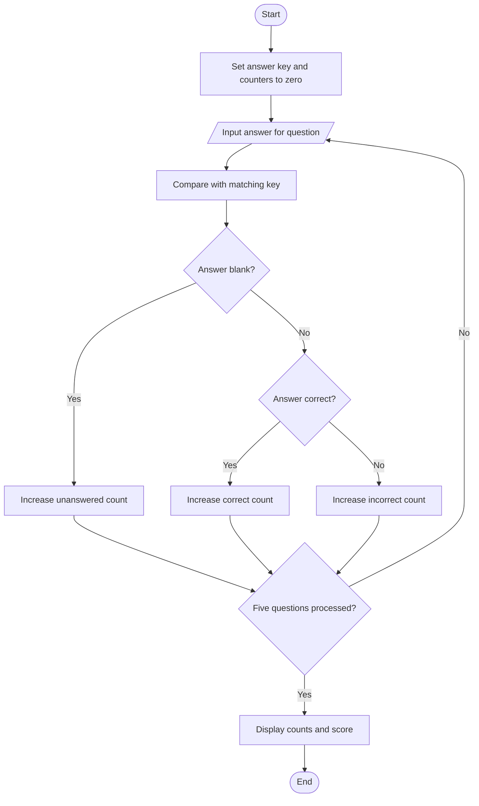

# Case Study 31: String-Based Examination Answer Evaluation

## Student Details

- **Name:** SIMHADRI RAJA SEKHARA REDDY
- **NRI Roll Number:** 26000784
- **NIAT ID:** N26V01A0424
- **Branch:** CSE
- **Section:** 5th Section
- **Year:** 1st Year

## 1. Problem Statement

Compare a student's answers with a short answer key, count correct, incorrect, and unanswered questions, and calculate a score.

## 2. Objectives

- Store answers in lists.
- Compare strings using a loop.
- Calculate a final score.

## 3. Assumptions

- There are five multiple-choice questions.
- Each correct answer earns 1 mark.
- Incorrect and unanswered answers earn 0 marks.
- Answers are entered as A, B, C, or D; a blank answer is unanswered.

## 4. Algorithm

1. Define the answer key.
2. Read five answers.
3. Compare each answer with the corresponding key.
4. Count correct, incorrect, and unanswered answers.
5. Display the counts and score.

## 5. Flowchart



## 6. Pseudocode

```text
START
SET key = [A, C, B, D, A]
SET correct = 0, incorrect = 0, blank = 0
FOR each answer position
  INPUT answer
  IF answer is blank: blank = blank + 1
  ELSE IF answer equals key at position: correct = correct + 1
  ELSE: incorrect = incorrect + 1
DISPLAY all counts and score
STOP
```

## 7. Python Source Code

See `main.py` in this folder. The program uses beginner-level Python concepts from the prescribed syllabus.

## 8. Test Cases

| Test | Input / condition | Expected result |
|---|---|---|
| 1 | A; C; B; D; A | 5 correct, 0 incorrect, 0 unanswered |
| 2 | A; B; blank; D; C | 2 correct, 2 incorrect, 1 unanswered |

## 9. Sample Output

See `sample_output.txt` and `output_screenshot.png`.

```text
Enter answer for question 1 (A/B/C/D or Enter to skip): A
Enter answer for question 2 (A/B/C/D or Enter to skip): C
Enter answer for question 3 (A/B/C/D or Enter to skip): B
Enter answer for question 4 (A/B/C/D or Enter to skip): D
Enter answer for question 5 (A/B/C/D or Enter to skip): A
Correct answers: 5
Incorrect answers: 0
Unanswered questions: 0
Final score: 5/5
```

## 10. Conclusion

The program compares answer strings using lists and loops and produces a simple examination result.
