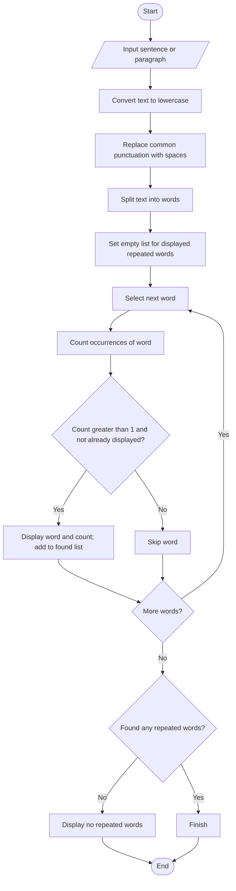

# Case Study 36: Repeated Word and Phrase Detection

## Student Details

- **Name:** SIMHADRI RAJA SEKHARA REDDY
- **NRI Roll Number:** 26000784
- **NIAT ID:** N26V01A0424
- **Branch:** CSE
- **Section:** 5th Section
- **Year:** 1st Year

## 1. Problem Statement

Read a sentence or paragraph, count how many times each word occurs, and display words that appear more than once.

## 2. Objectives

- Process text using string methods.
- Create and update lists.
- Identify repeated words.

## 3. Assumptions

- Words are separated by spaces or punctuation.
- The comparison ignores uppercase and lowercase differences.
- Basic punctuation is removed before counting.

## 4. Algorithm

1. Read a sentence or paragraph.
2. Convert it to lowercase.
3. Replace common punctuation with spaces.
4. Split the text into words.
5. For each word, count its occurrences.
6. Display words whose count is greater than one.

## 5. Flowchart



## 6. Pseudocode

```text
START
INPUT text
CONVERT text to lowercase
REPLACE punctuation with spaces
words = split text
FOR each word in words
  count = number of occurrences of word
  IF count > 1 AND word not already displayed: DISPLAY word and count
STOP
```

## 7. Python Source Code

See `main.py` in this folder. The program uses beginner-level Python concepts from the prescribed syllabus.

## 8. Test Cases

| Test | Input / condition | Expected result |
|---|---|---|
| 1 | Python is easy and Python is useful | python: 2; is: 2 |
| 2 | I like coding | No repeated words found |

## 9. Sample Output

See `sample_output.txt` and `output_screenshot.png`.

```text
Enter a sentence or paragraph: Python is easy and Python is useful
Repeated words:
python: 2 times
is: 2 times
```

## 10. Conclusion

The program uses lowercase conversion, splitting, list counting, and loops to detect repeated words.
