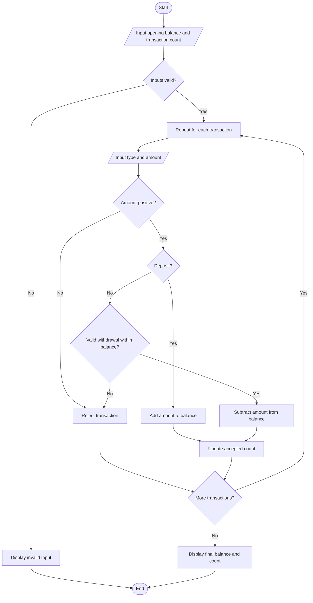

# Case Study 13: ATM Transaction Sequence Simulation

## Student Details

- **Name:** SIMHADRI RAJA SEKHARA REDDY
- **NRI Roll Number:** 26000784
- **NIAT ID:** N26V01A0424
- **Branch:** CSE
- **Section:** 5th Section
- **Year:** 1st Year

## 1. Problem Statement

Simulate a sequence of deposits and withdrawals, maintain an account balance, reject invalid transactions, and display a transaction summary.

## 2. Objectives

- Use a variable to maintain balance.
- Process repeated transactions using a loop.
- Apply conditions to deposits and withdrawals.

## 3. Assumptions

- The opening balance is non-negative.
- A transaction is entered as D for deposit or W for withdrawal.
- A withdrawal cannot exceed the available balance.

## 4. Algorithm

1. Read the opening balance and number of transactions.
2. Repeat for the given number of transactions.
3. Read transaction type and amount.
4. Accept a positive deposit or a withdrawal within the balance.
5. Reject invalid transactions.
6. Display final balance and accepted transaction count.

## 5. Flowchart



## 6. Pseudocode

```text
START
INPUT balance, n
SET accepted = 0
REPEAT n TIMES
  INPUT type, amount
  IF amount <= 0: DISPLAY invalid amount
  ELSE IF type is D: balance = balance + amount; accepted = accepted + 1
  ELSE IF type is W AND amount <= balance: balance = balance - amount; accepted = accepted + 1
  ELSE: DISPLAY transaction rejected
DISPLAY balance, accepted
STOP
```

## 7. Python Source Code

See `main.py` in this folder. The program uses beginner-level Python concepts from the prescribed syllabus.

## 8. Test Cases

| Test | Input / condition | Expected result |
|---|---|---|
| 1 | 1000, 2, D, 500, W, 200 | Final balance Rs. 1300; 2 accepted |
| 2 | 300, 1, W, 500 | Withdrawal rejected; balance Rs. 300 |

## 9. Sample Output

See `sample_output.txt` and `output_screenshot.png`.

```text
Enter opening balance: 1000
Enter number of transactions: 2
Transaction 1 (D for deposit, W for withdrawal): D
Enter amount: 500
Deposit successful.
Transaction 2 (D for deposit, W for withdrawal): W
Enter amount: 200
Withdrawal successful.
Final balance: Rs. 1300.00
Accepted transactions: 2
```

## 10. Conclusion

The simulation updates the account balance safely and demonstrates loops, conditions, and arithmetic operators.
