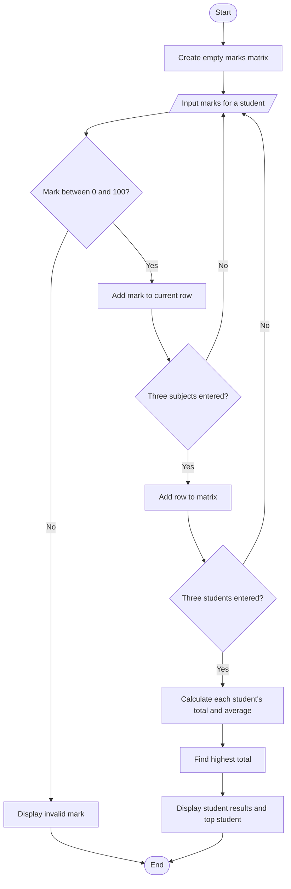

# Case Study 42: Student Marks Matrix Analysis

## Student Details

- **Name:** SIMHADRI RAJA SEKHARA REDDY
- **NRI Roll Number:** 26000784
- **NIAT ID:** N26V01A0424
- **Branch:** CSE
- **Section:** 5th Section
- **Year:** 1st Year

## 1. Problem Statement

Store marks for three students in three subjects using a nested list, calculate each student's total and average, and find the highest total.

## 2. Objectives

- Represent data using nested lists.
- Use nested loops to process marks.
- Calculate totals and averages.

## 3. Assumptions

- There are three students and three subjects.
- Marks are between 0 and 100.
- All students have marks for all three subjects.

## 4. Algorithm

1. Create an empty nested list.
2. Read marks for three students and three subjects.
3. Validate each mark.
4. Calculate each student's total and average.
5. Identify the student with the highest total.
6. Display the results.

## 5. Flowchart



## 6. Pseudocode

```text
START
SET marks = empty list
FOR each of 3 students
  SET row = empty list
  FOR each of 3 subjects: INPUT mark; APPEND mark to row
  APPEND row to marks
FOR each student row: calculate total and average; DISPLAY
FIND student with highest total
STOP
```

## 7. Python Source Code

See `main.py` in this folder. The program uses beginner-level Python concepts from the prescribed syllabus.

## 8. Test Cases

| Test | Input / condition | Expected result |
|---|---|---|
| 1 | 3 rows of 3 marks | Student 3 highest total 270 |
| 2 | 3 rows of 50 | Each total 150; averages 50 |

## 9. Sample Output

See `sample_output.txt` and `output_screenshot.png`.

```text
Enter marks for student 1:
  Subject 1: 70
  Subject 2: 80
  Subject 3: 90
Enter marks for student 2:
  Subject 1: 60
  Subject 2: 70
  Subject 3: 80
Enter marks for student 3:
  Subject 1: 90
  Subject 2: 90
  Subject 3: 90

STUDENT RESULTS
Student 1: Total = 240.00, Average = 80.00
Student 2: Total = 210.00, Average = 70.00
Student 3: Total = 270.00, Average = 90.00
Highest total: Student 3 (270.00)
```

## 10. Conclusion

The program demonstrates nested lists and nested loops to analyze marks for multiple students.
